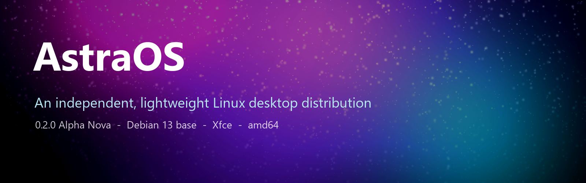

# AstraOS

<p align="center">
  
</p>

<p align="center">
  <a href="https://github.com/rafikulislammollaq-dev/astraos/actions/workflows/build-iso.yml"></a>
  <a href="https://github.com/rafikulislammollaq-dev/astraos/actions/workflows/validate.yml"></a>
  <a href="https://github.com/rafikulislammollaq-dev/astraos/actions/workflows/install-test.yml"></a>
  
  
  
</p>

An independent, lightweight Linux desktop distribution built from Debian packages.
**Version 0.2.0 Alpha, codename Nova, architecture amd64 (x86_64).**

AstraOS is a Debian 13 (trixie) derivative with its own package selection, Xfce desktop
configuration, branding, installer configuration and automated ISO build pipeline.
It uses the Debian Linux kernel. It is not a from-scratch kernel, not an official
Debian release, and not a website pretending to be an operating system.

---

## Try it

Three ways, cheapest first.

**1. Read the evidence.** Every claim on this page links to the CI run that proves it.
The maturity table below names the run number for each one, and the logs are attached
to the release. Nothing here is a screenshot of something that was set up by hand
to look right.

**2. Download the ISO.** The `Build ISO` workflow produces a bootable image, and the
release page carries the SHA-256 checksum, the build manifest and the boot logs.

**3. Build it yourself.** You need a Debian 13 host and about 25 GB of disk:

```bash
git clone https://github.com/rafikulislammollaq-dev/astraos.git
cd astraos
make bootstrap     # install the build dependencies
make iso          # build the image into dist/
```

Then boot `dist/*.iso` in VirtualBox. The full procedure, including what to expect
when it goes wrong, is in [docs/INSTALLATION_VIRTUALBOX.md](docs/INSTALLATION_VIRTUALBOX.md).

## What is inside

<p align="center">
  
</p>

- A themed Xfce desktop with its own wallpaper, panel, icons, cursor and login greeter.
- An assistant that can read your files and run commands, but has to ask first - a
  seven-step confirmation set, a sandbox, undo, and a step and time budget per task.
  The reasoning is in [docs/AI.md](docs/AI.md).
- An installer, a recovery path, and an APT archive the installed system can update
  from.
- A CI pipeline that builds the ISO, boots it three ways (BIOS, UEFI, and UEFI under
  Secure Boot with the Microsoft keys enrolled), installs it onto a blank disk, and
  boots the result with no medium attached.

## Documentation

| Document | What is in it |
|---|---|
| [docs/RELEASE-0.2.0-alpha.md](docs/RELEASE-0.2.0-alpha.md) | The 0.2.0 alpha release: what is in it, the run that proves each claim, and the screenshots it took |
| [docs/ARCHITECTURE.md](docs/ARCHITECTURE.md) | How the distribution is put together |
| [docs/AI.md](docs/AI.md) | The assistant, and why the confirmation set is shaped the way it is |
| [docs/BUILDING.md](docs/BUILDING.md) | Building the ISO, step by step |
| [docs/INSTALLATION_VIRTUALBOX.md](docs/INSTALLATION_VIRTUALBOX.md) | Running it in a virtual machine |
| [docs/INSTALLATION_PHYSICAL_PC.md](docs/INSTALLATION_PHYSICAL_PC.md) | Installing it on real hardware |
| [docs/HARDWARE_COMPATIBILITY.md](docs/HARDWARE_COMPATIBILITY.md) | What it is known to work on |
| [docs/KNOWN_LIMITATIONS.md](docs/KNOWN_LIMITATIONS.md) | What does not work yet |
| [docs/SECURITY.md](docs/SECURITY.md) | The security model and how to report a bug |
| [docs/RECOVERY.md](docs/RECOVERY.md) | Getting back in when it breaks |
| [docs/ROADMAP.md](docs/ROADMAP.md) | What comes next, and why |
| [CONTRIBUTING.md](CONTRIBUTING.md) | How to help |

---

## Maturity level: early alpha (live image boots in a VM; CI boots and self-tests it)

| Level | Meaning | Reached? |
|---|---|---|
| 1 | Source tree and static checks pass | Yes |
| 2 | ISO builds in CI | Yes (Build ISO run 38864588609, 2026-10-16: image built in about 18 minutes, 25/25 structural checks, `structural=PASS`, ISO 2,432,696,320 bytes) |
| 3 | ISO boots in a virtual machine | **Yes** (VirtualBox by hand, live session, 2026-10-15; QEMU in CI through the ISO's own boot menus on BIOS and UEFI, run 38919644411, 2026-10-16 — the image's own self-test reported PASS, 52 checks, and the captured screenshot carries the HUD — and under OVMF's Secure Boot-enforcing firmware with the Microsoft keys enrolled, run 39028358504, 2026-10-17) |
| 4 | Network and browser work out of the box | **Network proven in CI** (run 38919644411: NetworkManager active, an IPv4 address, a real name resolved by DNS); **no browser has been launched in a booted image yet** |
| 5 | Installer runs and installed system boots | **Yes** (run 39242006646, 2026-10-19: the ISO installed itself onto a blank disk through its own Calamares UI, the disk booted alone with no ISO attached, reached the LightDM greeter, and the image's self-test passed in installed mode — 51 checks, 0 failed) |
| 6 | Tested on physical hardware | Not tested yet |
| 7 | Secure Boot, signed images, stable release | **Secure Boot boots** (run 39028358504, 2026-10-17: the ISO reached the login prompt under OVMF's enforcing firmware with the Microsoft keys, the firmware verifying Microsoft-signed shim and Debian-signed GRUB and kernel); signed images and a stable release are not supported |

This is a learning and prototype build. Do not use it as your main system.

---

## What has been tested

Tested by hand on 2026-10-15 in Oracle VirtualBox on a Windows 11 host
(Intel Core i5-2500S, 16 GB RAM):

- ISO boots from the live menu ("Live system (amd64)").
- Reaches the Xfce desktop with the AstraOS wallpaper and a bottom dock
  (terminal, file manager, browser, search).
- Live user is `astra`, hostname is `astra-live`.
- Network link works: `ping 8.8.8.8` replies with 0% loss.
- Firefox loads websites once DNS is configured (YouTube loaded in the test).

Proven by CI on 2026-10-16 (boot self-test, run 38919644411, commit 8e40d99):

- The built ISO boots in CI's QEMU — under CPU **emulation** in that run, because the
  exercise's own `[ -w /dev/kvm ]` test failed: the runner's `/dev/kvm` is `root:kvm` and
  the runner user is not in the `kvm` group. Corrected 2026-10-19; run 39222797247 was
  the first to use the runner's own virtualisation (`install-boot: KVM acceleration
  enabled` in its transcript), which is what that device is there for — and the image's
  own self-test reports `RESULT: PASS (64 checks,
  0 failed)` (run 39564153919, 2026-10-21): the console login prompt appears by the 141 s mark, LightDM is
  active, an Xfce session (xfwm4) runs as the live user, every `astraos-*`
  package is present at its expected version, the hardware, codec and
  compatibility tools and the Flathub remote check out, NetworkManager is
  active with an IPv4 address, a real name resolves over DNS, the firewall is
  up with only the assistant's page reachable from the private network (a
  watched port stayed unreached under the host's probe), and a phone completed
  the pairing arc against the assistant's page. The self-test starts the
  dashboard before the capture, so the screenshot shows the HUD itself.
- This boots the kernel and initrd taken from the ISO with the ISO attached as
  the live medium; the ISO's own boot menus (syslinux BIOS, GRUB EFI) boot the
  image through QEMU's own firmware in the same dispatch, both reaching the live
  login prompt. The screenshot captured through the QEMU monitor shows the HUD
  dashboard itself: the clock, the system and terminal panels, the memory and
  filesystem bars and the endpoint card standing at "NO ENDPOINT".

Tested from the source tree on 2026-10-16 in WSL on the same hardware:

- The AstraOS HUD renders. Started with the same command the installed shim runs,
  under GTK 3 on a virtual X display, it paints its full layout - the clock, the
  per-core and memory meters, the process and filesystem tables, the traffic
  graph, the world-view panel and the on-screen keyboard - with no warnings.
  Three defects that stopped the very first frame were found and fixed by doing
  this (see `fix(hud)` in the log for 2026-10-16).

Built and proven on GitHub Actions on 2026-10-16 (Build AI engine run #1, about
5 minutes, from the commit that added the workflow):

- The assistant's engine compiles through the assistant's own command,
  `astra-ai setup --build all`, and the built binaries pass the checks this
  hardware taught us: no FMA, BMI2 or F16C instruction, no RPATH into the build
  tree, no missing library.
- The engine loads a real model and answers over HTTP on an *emulated Sandy
  Bridge* (`qemu-x86_64 -cpu SandyBridge`) - the same CPU class as this machine,
  whose missing FMA/BMI2 once killed the process with SIGILL and no output.
- A model downloads with `astra-ai setup --model`, `astra-ai ask` answers and
  stops, `astra-ai work --json` takes a request through the ladder, and the
  worker's JSON grammar is shown to be enforced even when the model is told to
  answer in prose. (The model in this proof is the 360M router-class entry, the
  smallest in the catalogue: a smoke test of the engine, not a test of the
  ladder's answer quality.)

The installer is no longer on that list. On 2026-10-19 (run 39242006646) the ISO installed
itself onto a blank virtual disk through its own Calamares UI, driven over the QEMU
monitor; the disk then booted alone with no ISO attached, reached the LightDM greeter, and
the image's self-test passed in installed mode — 51 checks, 0 failed. Getting there took a
different named defect in every exercise, all recorded in `CHANGELOG.md`; the last two were
a `bootloader.conf` that replaced Calamares' own without carrying every key its module
reads, and a `mount` module config that did not exist at all, so the target had no `/dev`
for `grub-install`. What that run does *not* prove is listed in
`docs/KNOWN_LIMITATIONS.md`: the installation is virtual, legacy BIOS, one ext4 partition,
unencrypted, nobody has logged in to the installed system, and no physical machine has run
any of it.

Not tested: Wi-Fi, GPUs, physical machines, Secure Boot on real hardware, audio, printing,
Bluetooth, the SPICE and VMware guest tools against those hypervisors' interfaces (the QEMU
agent answers the host in CI — run 39028358504), and the assistant's web page beyond the
pairing arc.

---

## What is included

Built from Debian 13 (trixie). The image comes from 352 distinct reviewed package
selections across 10 package lists plus their dependencies and recommended packages. The
most recent completed build, made before the offline assistant bundle was added, held
182,962 files (2,159 MiB extracted); the next build's measured figures replace these when
they exist, rather than being estimated here.

| Component | Choice |
|---|---|
| Base | Debian 13 (trixie) |
| Kernel | Debian `linux-image-amd64` (6.12 series), plus kernel headers |
| Init | systemd |
| Desktop | Xfce, configured and branded |
| Session dashboard | AstraOS HUD (`astraos-hud`): one full-screen window with live CPU, memory, network, disk and temperature panels, an on-screen keyboard and an embedded terminal, started from its menu entry or launcher |
| Assistant | `astraos-ai`: a local assistant that ships with an executor model and a speech model, so it works offline on first boot, with Guard permissions/audit, a three-tier model ladder and a shipped skills/knowledge library. The middle brain is an optional download (`docs/AI.md`) |
| Help centre | "AstraOS Help Centre": every how-do-I page and every procedure the assistant knows, in one offline page with a search box - no network needed, nothing fetched from anywhere. It also answers "can I run this app on Windows?" with the honest ladder: native, Wine, browser, or no |
| Conversions | The assistant converts files: a document or spreadsheet to PDF, a picture to JPG (or smaller, or rotated), a PDF back to text. It says what it will produce first, checks the result, and never overwrites a file that is already there |
| Coming from elsewhere | Guides for people arriving from Windows, from Android and from KDE Plasma (or Mint, or Ubuntu) - what changes, what is the same, and what is honest - plus one for the first thirty minutes |
| Proof | Every CI run publishes a proof page (the image's hash, the structural checks, the self-test, each firmware path, the install, and what the run does *not* prove) and a bill of materials for the packages it built |
| First run | First-login guidance (`astraos-welcome`, shown once) and a searchable offline help centre ("AstraOS Help Centre" in the menu) |
| Getting out | `astraos-reset --settings` puts the desktop and session back to how it shipped, keeps every file, and sets the old settings aside in your own state directory; `--factory` explains how to reinstall from scratch, and the installer is the thing that erases |
| Diagnostics | `astraos-doctor`: a read-only health report (machine, disks, memory, services, logs, network, graphics) and a `--share` mode that redacts the user name, the host name, the addresses, the MAC addresses, the machine id and any serial number before you paste it into a bug report |
| Hardware enablement | VA-API video decode for Intel and AMD (`intel-media-va-driver`, `i965-va-driver`, `mesa-va-drivers`) with `vainfo`; `fwupd` for device firmware updates; `zram-tools` compressed swap; `irqbalance`; `bluez-firmware` |
| Virtual machines | Guest agents for the hypervisors people try first: `qemu-guest-agent` (QEMU/KVM: clean shutdown, time sync, host queries), `spice-vdagent` (SPICE: clipboard and display resize) and `open-vm-tools` with its desktop plugins (VMware). All start only inside their own hypervisor — udev rules on the virtio ports, or a unit conditioned on VMware. VirtualBox's Guest Additions are not in Debian 13, so in VirtualBox use that application's own Guest Additions ISO (see `docs/TROUBLESHOOTING.md`) |
| Phones and media over USB | MTP for Android phones and cameras in Thunar (`libmtp-runtime`, `mtp-tools`), `adb` and `fastboot` with udev rules |
| Disk compatibility | `ntfs-3g` (read-write Windows disks), `exfatprogs` (SD cards and cameras), `squashfs-tools` |
| Media codecs | `libavcodec-extra`, `ffmpeg`, the GStreamer libav/bad/ugly set, DVD navigation (`libdvdnav4`) |
| Printing | CUPS with the gutenprint and Epson (`escpr`) driver sets |
| Application store | Flatpak with the Flathub remote configured system-wide; no applications preinstalled |
| Windows software | Wine (64-bit applications) and winetricks |
| System tools | `gdebi`, `timeshift`, `inxi`, `speech-dispatcher` |
| Self-test | `astraos-smoke` reports the machine, session, packages and networking on request (kernel command line `astraos.ci=1`); the CI boot test runs it on every build |
| Display manager | LightDM (GTK greeter) |
| Display server | X11 |
| Boot splash | Plymouth, AstraOS theme |
| Installer | Calamares, configured and branded; CI installs the image onto a blank disk, boots the disk alone, reaches the greeter and passes the self-test in installed mode (run 39242006646, 2026-10-19). Every defect that stood in the way is in `CHANGELOG.md` |
| Bootloader | GRUB (UEFI) and syslinux (BIOS), hybrid ISO; Debian's signed Secure Boot chain carried, and it boots under OVMF's enforcing firmware in CI (run 39028358504, 2026-10-17) |
| Networking | NetworkManager with applet, wpa_supplicant |
| Browser | Firefox ESR |
| Office | LibreOffice |
| Firewall | ufw enabled by default: incoming denied except the assistant's page (8765/tcp) and local service discovery (5353/udp), both from the local network only |
| Firmware | Broad set of non-free firmware (about 390 MB compressed) |
| Package format | `.deb` with APT and dpkg |
| Root filesystem | ext4 |

Largest contributors to ISO size: kernel about 108 MB, firmware packages about 390 MB in
total, the assistant's executor model about 1.0 GB, Wine, Flatpak, the full codec set,
Firefox ESR about 80 MB, LibreOffice about 80 MB, graphics libraries (LLVM, Mesa,
WebKitGTK), fonts and speech data.

The next ISO is expected to be about 3.5 GB: the last measured image was 2,432,696,320
bytes, and the assistant's executor, speech model and engine add about 1.1 GB. No ISO
has been rebuilt with the bundle yet, so that figure is arithmetic, not a measurement;
the first green build records the exact size. Installed size will be larger, because
the ISO stores the system as a compressed squashfs.

---

## Known issues

1. **Secure Boot boots under QEMU's enforcing firmware; real hardware is untested.**
   The image carries Debian's signed shim/GRUB/kernel chain and CI boots it to the
   live system's login prompt under OVMF's Secure Boot firmware with the Microsoft
   keys enrolled (run 39028358504, 2026-10-17) — the firmware verified the chain
   rather than refusing the medium. No physical machine has been tried, and if yours
   refuses the medium, turn Secure Boot off to try AstraOS.
2. **Copy and paste between the host and a virtual machine depends on the hypervisor's
   guest tools.** The image ships the guest agents (see "Virtual machines" above). The
   QEMU agent is exercised in CI — it answers the host over its virtio serial port
   (run 39028358504) — but clipboard and display resize have not been exercised
   against a real hypervisor's interface: in QEMU/KVM with SPICE they come from
   `spice-vdagent`, in VMware from `open-vm-tools`, and in VirtualBox you must install
   VirtualBox's own Guest Additions from its CD image — Debian 13 does not package the
   VirtualBox guest utilities, so AstraOS cannot ship them. Right Ctrl releases the
   mouse; inside the terminal copy is Ctrl+Shift+C and paste is Ctrl+Shift+V.
3. **Physical hardware is untested, and the proven installation is one narrow one.** The
   image boots in virtual machines — by hand in VirtualBox through the live menu
   (2026-10-15), and in CI under QEMU through its own boot menus on BIOS and UEFI — and in
   CI it installs onto a blank virtual disk and boots that disk alone (run 39242006646,
   2026-10-19). That exercise is legacy BIOS, one ext4 partition, no encryption and no
   swap, and nobody logs in afterwards. Nothing has run on physical hardware.
4. **The ISO is larger than it needs to be** (about 2.4 GB: APT recommends are on, and
   the codec, Wine and Flatpak sets are included).
5. **`/etc/os-release` may be overwritten by a future upgrade of Debian's `base-files`.**
   Cosmetic: AstraOS's own tools read `/etc/astraos-release`.
6. **The theme is colour-only**; window decorations use the upstream xfwm4 theme.

Fixed defects are recorded in `CHANGELOG.md`. The complete list of limitations, in more
detail than this summary, is `docs/KNOWN_LIMITATIONS.md`.

---

## Requirements to run it

**Virtual machine (recommended):**

- Host: Windows, Linux or macOS with VirtualBox, VMware or QEMU
- 2 or more CPU cores, 4 GB RAM (2 GB minimum), 25 GB virtual disk
- 64-bit x86 host with hardware virtualization enabled
- ISO type: Linux, Debian (64-bit). Skip Unattended Installation.
  Try EFI off first, and turn it on if the VM will not boot.

**Physical hardware:** not tested and not recommended yet.

---

## Quick start in VirtualBox

1. Download the ISO, `.sha256` and `.manifest` from the Build ISO run's artifacts
   (GitHub Actions, `astraos-iso`) and unzip.
2. Verify the download in PowerShell:
   ```powershell
   Get-FileHash .\astraos-0.2.0-alpha-amd64.iso -Algorithm SHA256
   Get-Content .\astraos-0.2.0-alpha-amd64.iso.sha256
   ```
   The two hashes should match.
3. VirtualBox: New. Set name `AstraOS`, pick the ISO, Type Linux, Version Debian (64-bit),
   tick Skip Unattended Installation.
4. Hardware: 4096 MB RAM, 2 CPUs, 25 GB disk. Finish.
5. Start the VM, choose **Live system (amd64)**, wait for the desktop.
6. Open Firefox. 0.2.0 builds configure DNS themselves; nothing to fix first.
7. Press Right Ctrl to release the mouse from the VM.
   In the terminal, copy is Ctrl+Shift+C and paste is Ctrl+Shift+V.

---

## Building the ISO

Without a Linux machine, use CI: run the **Build ISO** workflow manually from the
Actions tab. It takes about 18 minutes to produce the image and then boots it in QEMU
for the image's own self-test (the `smoke-boot` job), producing the `astraos-iso`,
`astraos-build-logs` and `astraos-boot-self-test` artifacts.

On a Debian or Ubuntu host:

```bash
./scripts/validate-environment.sh        # can this host build AstraOS?
./scripts/bootstrap-build-environment.sh # install build dependencies
./scripts/build-iso.sh                   # build the image
```

The ISO is written to `dist/` with a `.sha256` checksum and a `.manifest`.
See `docs/BUILDING.md`.

## Testing

```bash
make check          # or: python3 tests/run.py
```

The static suite checks configuration, package lists, assets, desktop entries,
Calamares safety settings and shell syntax. A green run means the repository is
consistent, not that AstraOS works.

CI goes one step further on every image it builds: the `smoke-boot` job boots the ISO
in QEMU and runs the image's own self-test (`astraos-smoke`, started only when
`astraos.ci=1` is on the kernel command line), keeping the serial log and a screenshot of
the booted desktop as the `astraos-boot-self-test` artifact. The same check runs by
hand with `./scripts/smoke-boot.sh dist/astraos-*.iso` (see `docs/BUILDING.md`).

An `install-boot` job goes further still: it installs the ISO onto a blank disk through
the ISO's own Calamares UI, driven over the QEMU monitor, then boots the installed disk
alone and requires the image's self-test in its installed mode. It went green for the first
time on 2026-10-19 (run 39242006646): the installation completed, the disk booted with no
ISO attached, the LightDM greeter appeared, and the self-test reported `PASS (51 checks,
0 failed)` in installed mode. Every failure and fix on the way is in `CHANGELOG.md`;
`docs/BUILDING.md` describes the exercise, and `.github/workflows/install-test.yml` re-runs
the same one against a stored ISO when a change is driver-only and needs no rebuild.

---

## The assistant's engine, built in CI

Compiling llama.cpp costs about twenty minutes of every core on this hardware, so it does
not happen on this hardware. The **Build AI engine** workflow builds `llama-server` and
`whisper-cli` on GitHub Actions - through the same command a user runs,
`astra-ai setup --build all`, so the workflow cannot drift from the flag list in
`setup.py` - proves the binaries, and uploads them with `SHA256SUMS.txt` and
`BUILD-INFO.txt`. It does this once per CPU variant: the `avx` build is the reference
one, and its proof is on an *emulated Sandy Bridge* - the engine loads a real model and
answers over HTTP with no illegal instruction in sight - while the `avx2` build (Haswell
and later, most of ggml's speed on those machines) is proven natively on the runner,
with a disassembly check that 256-bit code is actually there and a guard that refuses to
run on a runner without AVX2. The artifacts are named apart:
`astra-ai-engine-linux-x86_64-avx` and `astra-ai-engine-linux-x86_64-avx2`.

`astra-ai status` reports which variant the installed binaries were built for and flags
the mismatch when the CPU cannot run them - the build tool records it, and `--variant
auto` picks from the machine's own profile. No variant ever compiles for the build
machine's own instruction set (`GGML_NATIVE=OFF`).

To install a completed build: open the latest run on the Actions tab, download and unzip
the artifact whose name matches the machine - `...-avx` for Sandy Bridge and later,
`...-avx2` for Haswell and later - copy `llama-server` and `whisper-cli` into
`~/.local/share/astraos/ai/bin/`, and run `astra-ai status`, which prints the path it
found. Building on the machine still works and is still documented in `docs/AI.md`:
`astra-ai setup --build all --variant auto`.

---

## Repository layout

```
astraos/
├── VERSION           release identity
├── Makefile          make check / build / validate / checksums / clean
├── config/           distribution settings, branding, package lists, live-build config and hooks
├── branding/         original artwork and the asset renderer
├── desktop/          Xfce configuration, launchers, autostart, GTK theme
├── apps/             runnable applications packaged from this tree (astraos-hud)
├── packages/         AstraOS .deb packages and their sources
├── system/           identity files and kernel/security default templates
├── installer/        Calamares configuration and branding
├── scripts/          validation, packaging, build and release tooling
├── tests/            static test suite
├── docs/             architecture, build, installation, recovery, limitations, roadmap, blueprints
└── build/  dist/     generated output (git-ignored)
```

The code is mostly build tooling: about half Python and half Shell, with a small amount
of HTML, CSS and Make. The operating system itself comes from Debian packages.

---

## Roadmap

1. ~~Fix DNS so networking works out of the box~~ **Done in 0.2.0**: `resolvconf` was
   removed from the package list and `tests/static/test_packages.py` keeps it out.
2. ~~Confirm the ISO passes structural validation in CI~~ **Done** (every build records
   `structural=PASS`; latest 2026-10-16, run 38864588609).
3. Test the Calamares installer: install to a VM disk and boot the installed system.
4. Reduce ISO size (turn off APT recommends, trim firmware and large optional apps).
5. ~~Add Guest Additions support for VMs~~ **The VirtualBox kind is impossible from
   Debian 13** (nothing in main/contrib/non-free packages the guest utilities; only
   Debian's unstable suite does, and this project ships its pinned release), so
   VirtualBox users install VirtualBox's own Guest Additions ISO. The QEMU/KVM (SPICE
   included) and VMware agents now ship in the image, and the QEMU agent is exercised
   in CI (run 39028358504: it answers the host over its virtio serial port;
   `CHANGELOG.md`).
6. Test on physical hardware.
7. See the AstraOS HUD on a booted ISO's screen. It renders from the source tree
   under GTK 3 on a virtual display (2026-10-16), but no built image has shown it
   on a real screen yet.
8. Run the assistant end to end on this machine with the recommended ladder. The
   engine, the `ask`/`work` path and the worker's JSON grammar are now proven in CI
   (Build AI engine, 2026-10-16, including an emulated Sandy Bridge and the 360M
   model), and the 1.7B executor is downloaded here; what remains is running the
   ladder on this machine's own CPU and reaching its web page from a phone.
9. ~~Exercise the ISO's own boot menu in CI~~ **Done**: the `boot-menus` job boots the
   ISO through syslinux (BIOS), GRUB (UEFI) and GRUB under Secure Boot-enforcing
   firmware (run 39028358504, 2026-10-17 — all three reached the login prompt; runs
   38913161772 and 38919644411 came before it).

Beyond this list, `docs/ROADMAP.md` holds the staged plan for the assistant as a
platform — permissions and sandboxing, hardware-adaptive model selection, voice,
local knowledge, diagnostics. It is a plan, not a description of the current system;
nothing in it should be read as working until a run, a test or an artifact shows it.

---

## Licensing and attribution

AstraOS is distributed under the GNU General Public License, version 3 or later. See `LICENSE`.

AstraOS is an independent distribution based on Debian GNU/Linux and is not affiliated
with, endorsed by, or an official release of the Debian Project. It includes software
from Debian, the Linux kernel, Xfce, LightDM, Plymouth, GRUB, Calamares, Firefox and many
other projects; each keeps its own copyright and licence, recorded in
`/usr/share/doc/<package>/copyright` on an installed system.

All AstraOS artwork is original to this project.
